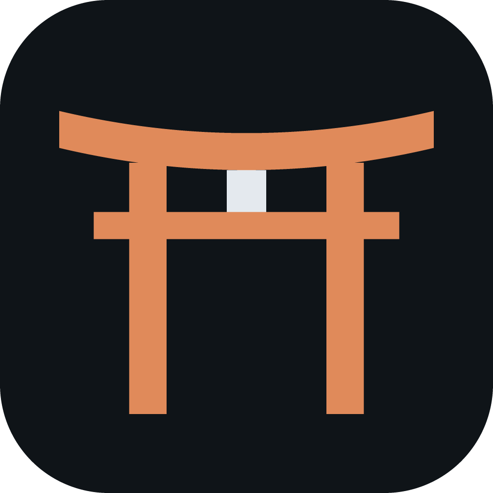
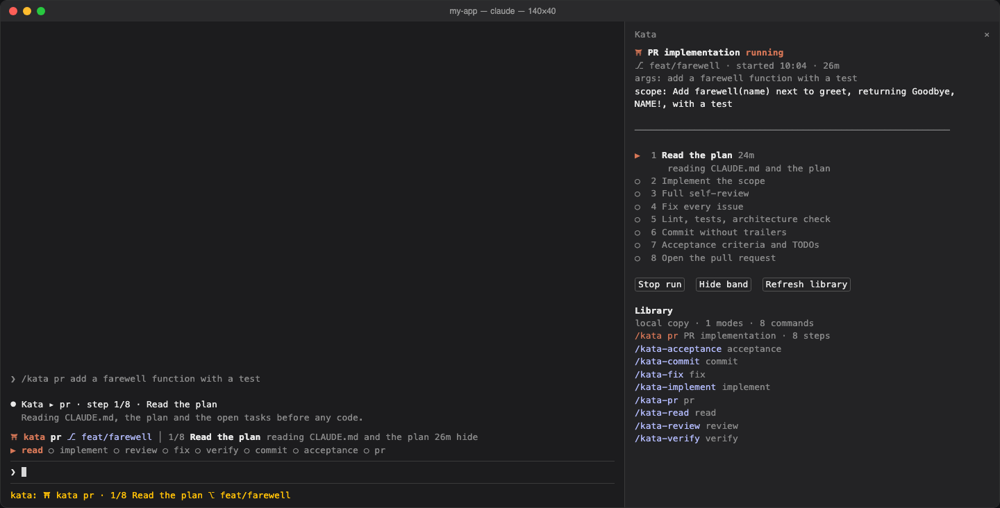
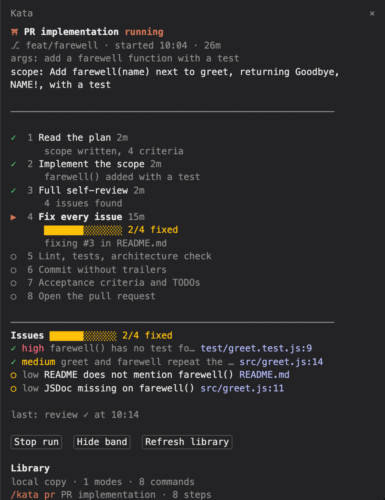
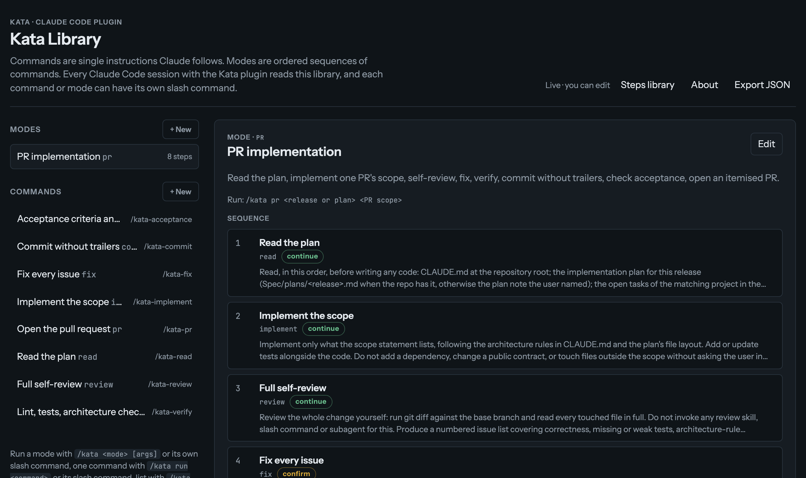
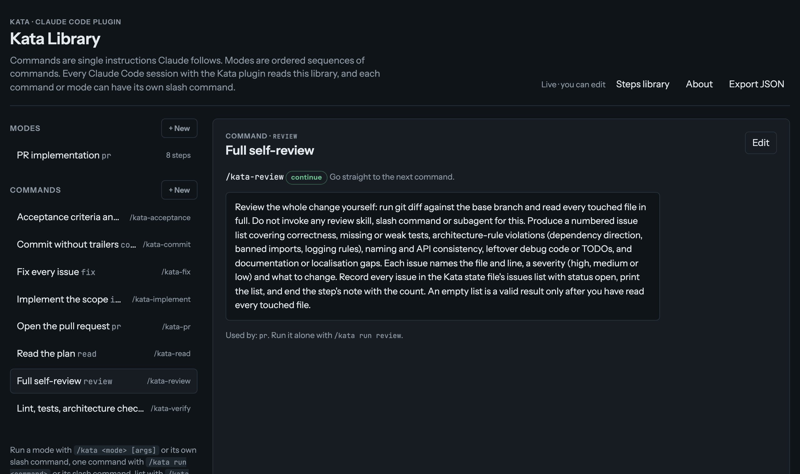
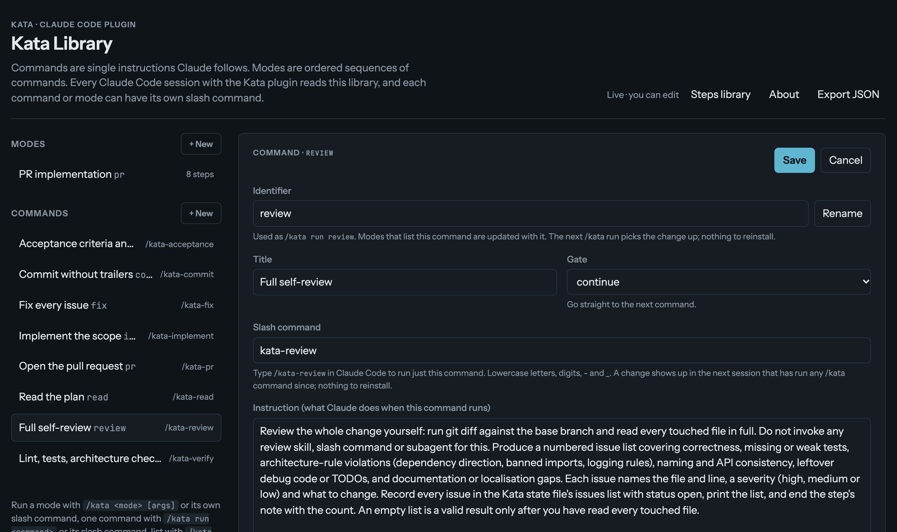
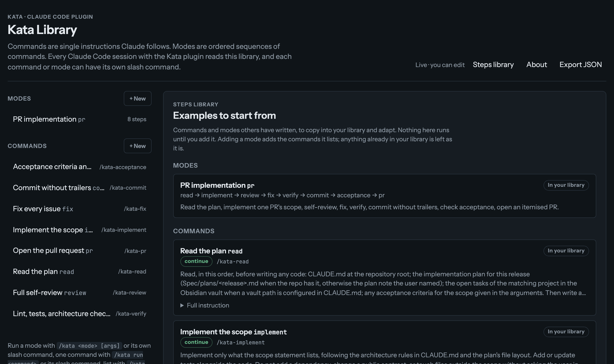
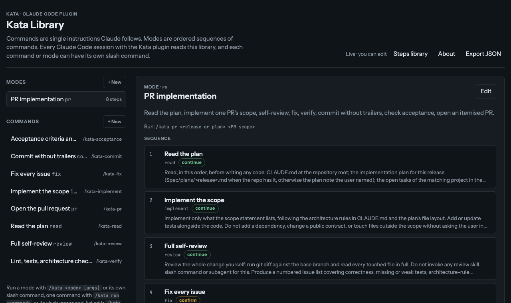
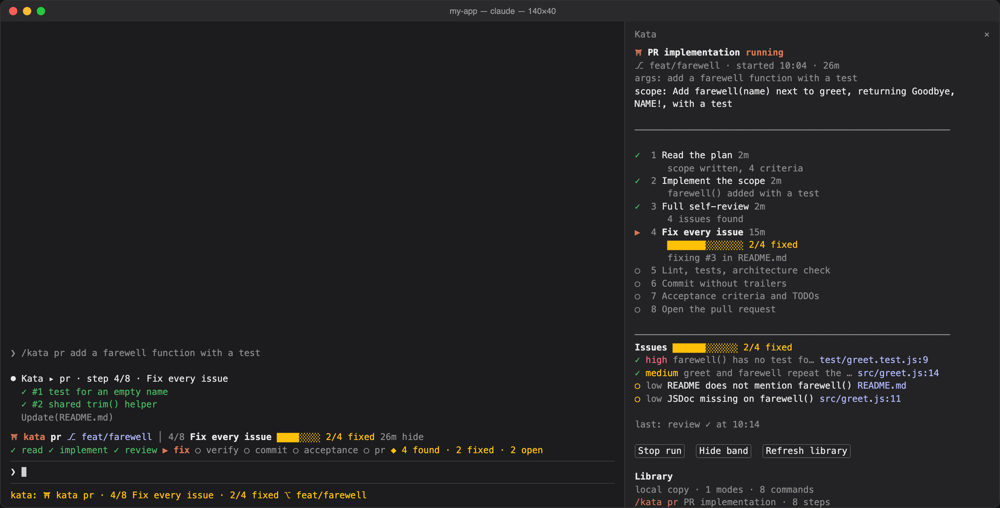

# Kata



Practised sequences for Claude Code.

In martial arts a *kata* is a sequence of moves you drill until it runs on its own. Kata does the same for the work you repeat with Claude. You write each step once as a **command**, chain commands into **modes**, and run them from any terminal session, either a whole mode or a single step, each with its own slash command. While a run goes, Kata shows where it is: the current step, the issues a review found and how many are fixed, the branch, and every step's outcome.



## Install

In a Claude Code session:

```
/plugin install kata --marketplace DeepanshuGautam/kata
```

Answer `y` to add the marketplace, then pick a scope. From a shell: `claude plugin install kata --marketplace DeepanshuGautam/kata`.

On claude.ai or the Claude desktop app: Customize → Plugins → Add → **Add marketplace** → `DeepanshuGautam/kata`, then add **Kata**. It syncs into every Claude Code session signed in with the same account.

## Quick start

A new install starts with an empty library: yours to fill.

```
/kata-setup                     your own private Kata Library page on claude.ai, connected
/kata examples                  the steps library: example commands and modes to copy
/kata-edit add example pr       copy the pull-request workflow below into your library
/kata modes                     the modes you can run
/kata pr "add a logging package" run a mode
/kata-review                    run one step on its own, by its slash command
/kata-panel                     open the live pane
```

Plugin skills are namespaced, so `/kata` is also `/kata:kata`. The Kata mod registers the short name for you.

## Commands, modes and slash commands

A **command** is one instruction Claude carries out, written as an order: "Review the whole change yourself…". It has a title, a gate and an optional slash name.

A **mode** is an ordered list of commands, such as `pr`: read → implement → review → fix → verify → commit → acceptance → pr. One command can sit in many modes, and an edit to it reaches all of them.

**Gates** decide what happens after a step: `continue` goes on, `confirm` pauses and asks you first, and `stop-on-fail` ends the run when the step fails.

**Slash commands**: give any command or mode a `slash` name and the mod registers it. `/kata-review the logging package` runs `/kata run review the logging package`, and a mode's slash name runs the whole mode. A library can hold any number of commands and modes.

## Showcase: a pull-request workflow

This is the workflow Kata was built for, and it ships in the **steps library** (`library/examples.json`) for you to copy and adapt. It is not in your library until you add it.

| Step | Command | Slash | Gate | What Claude does |
|---|---|---|---|---|
| 1 | `read` | `/kata-read` | continue | Reads CLAUDE.md, the plan and the open tasks, then writes a scope statement with acceptance criteria |
| 2 | `implement` | `/kata-implement` | continue | Implements only the scope, with tests, and asks before touching anything outside it |
| 3 | `review` | `/kata-review` | continue | Reviews the whole diff itself and records every issue with severity, file and line |
| 4 | `fix` | `/kata-fix` | confirm | Fixes each open issue, counting fixed out of found, and asks you in plain text when a decision is needed |
| 5 | `verify` | `/kata-verify` | stop-on-fail | Runs lint, tests and the architecture check until they pass, or stops the run |
| 6 | `commit` | `/kata-commit` | continue | Commits only the scoped files, Conventional Commits, no trailers |
| 7 | `acceptance` | `/kata-acceptance` | continue | Checks every criterion with evidence and loops back to implement for anything unmet |
| 8 | `pr` | `/kata-pr` | continue | Opens the pull request with Summary, Description, Testing and Checklist |

Run it as `/kata pr "1.0 PR 3 logging package"`, or any single step by its slash command. While it runs, the band and the pane show where it is:



Build your own the same way: a docs pass, a release, a migration, a bug triage. Each command is one instruction written as an order, and each mode is the order you run them in.

## Where your library lives

| Source | When it is used |
|---|---|
| **Kata Library page** (claude.ai artifact) | When the library source is `artifact` and a page URL is set. `/kata-setup` makes one for you. Edit commands and modes there, reorder steps, rename, set slash names, export JSON. |
| **Local file** `~/.claude/kata/library.json` (or `$KATA_HOME/library.json`) | The offline copy of the page, or your only library when the source is `local`. Edit it with `/kata-edit` or by hand. |
| **Bundled** `library/default.json` | Empty: a fresh install, until either of the above exists. |

The page also has a **Steps library**, where you add example commands and modes with one click, and an **About** view.

Edits on the page reach your terminal sessions when a session starts, every ten minutes, on `/kata-refresh`, and at every `/kata` call. A new or renamed slash command is registered within seconds of that, with nothing to reinstall. `/kata-sync` pulls the page with a diff, and `/kata-sync --from file.json` imports an export.

Share the page with your team, and everyone with the plugin runs the same steps. Only people with edit access can change it.

## The Kata Library page

Your commands and modes live on a private claude.ai page that every Claude Code session with the plugin reads.

| The `pr` mode and its eight steps | A command, with its slash command and gate |
|---|---|
|  |  |
| **Editing a command in place** | **The Steps library, to copy examples from** |
|  |  |



## Watching a run



The `/kata` skill runs the steps and writes `.kata/state.json` in the project, which ignores itself in git. The mod draws it:

- **Band above the prompt:** the mode, the branch, the current step with its progress bar, a trail of every step, and the issue counts. Press *hide* to hide it.
- **Status line:** the same headline in one line.
- **Pane** (`/kata-panel`): every step with its status, duration, activity and note; every issue with severity, file and line, fixed or open; the last command; buttons to stop the run, show or hide the band, and refresh the library. With no run, it lists your modes and commands with their slash commands.
- **Toasts** when a run starts, a step ends and a run ends, plus a **native notification** when a run waits for you or finishes.
- **Commit guard:** during a run, a `git commit` whose message carries `Co-Authored-By`, `Generated with` or `Signed-off-by` is refused. You can set this to always or never.

Commands report progress in a generic way, so your own commands light up the same mods. A step that finds things records them as issues, a step that works through a list reports `done/total`, and a running step names its current activity. The review, fix, verify and acceptance commands in the steps library show the pattern.

## Settings (`/config` → Kata)

| Setting | Default | Meaning |
|---|---|---|
| Library source | artifact | `artifact` or `local` |
| Kata Library artifact URL | empty | the page holding your commands and modes (`/kata-setup` fills it in) |
| Block commit trailers | during-kata | `during-kata`, `always`, `never` |
| Show the run band | on | the band above the prompt during a run |
| Notify when a run waits or ends | on | native notifications through your terminal |

## Commands

| Command | What it does |
|---|---|
| `/kata MODE [args]` | Run a mode |
| `/kata run COMMAND [args]` | Run one command |
| `/kata modes`, `/kata commands` | List the library |
| `/kata examples` | Browse the steps library |
| `/kata status`, `/kata stop` | Show or end the current run |
| `/kata-setup [URL] [--local]` | Create or connect your Kata Library page |
| `/kata-edit …` | Create, change, rename or delete commands and modes, or `add example ID` from the steps library |
| `/kata-sync [--from file]` | Pull the page into the local file, showing what changed |
| `/kata-refresh` | Pull the page now and re-register slash commands |
| `/kata-panel` | Open the pane |
| `/<slash>` | Any command or mode's own slash command |

## What Kata runs, reads, writes and sends

Kata has no server, collects nothing and sends no telemetry. The hooks module (`hooks/register.tsx`) is plain TypeScript, and so is everything else; nothing is compiled or minified.

- **Reads:** the run state file `<project>/.kata/state.json`, which the `/kata` skill writes; the local library copy `~/.claude/kata/library.json` (or `$KATA_HOME/library.json`); and the bundled `library/default.json`, which is empty.
- **Writes:** only the local library copy, when it pulls your Kata Library page. The `/kata` skill writes the run state file through Claude's own tools.
- **Reads your Kata Library page** on claude.ai through Claude Code's own `ArtifactData` tool, when you set its address in `/config`: at session start, every ten minutes and on `/kata-refresh`. It never asks for permission to do this. If the tool isn't available, or using it would ask, it uses the local copy instead.
- **Runs** `git branch --show-current` (and `git rev-parse --short HEAD` on a detached head) in your project, to show the branch. Nothing else.
- **Adds to Claude's context** one short section with your Kata settings and the ids of your commands and modes, so Claude doesn't have to ask for them.
- **Registers slash commands:** `/kata-panel`, `/kata-refresh`, `/kata` when plugin skills are namespaced, and one for each command or mode in your library that has a `slash` name. Each one only runs `/kata` with that id.
- **Blocks** a `git commit` whose message carries `Co-Authored-By`, `Generated with` or `Signed-off-by` during a run (or always, or never, per the setting). If the check itself fails, the commit goes ahead.
- **Shows** a band above the prompt, a status line, a pane, toasts, and a native notification through your terminal when a run waits for you or ends (turn it off with the notify setting).

### The mod in detail, for reviewers

Everything below is in `hooks/register.tsx`, readable TypeScript.

- **Programs it runs:** only `git branch --show-current` and, on a detached head, `git rev-parse --short HEAD`, written as fixed text, in the project folder, with a 5-second timeout. They read the branch name for the band, status line and pane. No other program, shell or package launcher.
- **Tools it calls itself:** only `ArtifactData` with `action: "list"` on the `commands` and `modes` collections of the Kata Library page whose address you set in `/config`. It calls it at session start, every ten minutes and on `/kata-refresh`, and only after `tool.check` says the call is allowed without asking. It reads; it never writes to the page.
- **Slash commands it runs itself:** `/kata` (or `/kata:kata`) with the arguments for the step or mode you just typed as one of your library's slash commands, for example `/kata-review x` runs `/kata run review x`; `/kata stop` when you press Stop run in the pane; `/kata-refresh` when you press Refresh library. Nothing else, and never on its own.
- **Files it writes:** only `~/.claude/kata/library.json` (or `$KATA_HOME/library.json`), the local copy of your own Kata Library page. That file holds the commands and modes you wrote, which the `/kata` skill gives Claude as instructions; it is meant to be that, and it holds nothing else.
- **Environment it reads:** `HOME` and `KATA_HOME`, only to build that file's path. It reads no credential, token or key.
- **What it sends, and where:** nothing leaves your machine through the mod. The page read goes through Claude Code's own `ArtifactData` tool to your own claude.ai page. Notifications go to your terminal through Claude Code's notification channel.
- **What its hooks change:** `prompt.compose` appends one section, `kata:config`, with your Kata settings and the ids of your commands and modes; the system prompt is otherwise untouched. `command.run` answers `/kata-panel`, `/kata-refresh`, `/kata` (when the skill is namespaced) and your library's slash commands, and passes every other command on unchanged. `tool.call` on Bash refuses a `git commit` whose message carries a trailer during a run (per the setting) and passes every other call on unchanged; other `tool.call` events are only observed to refresh the display. `ui.render` draws only the band above the prompt (`AbovePrompt`) and its own pane (`Pane`, id `kata`). It never changes a permission mode, a setting or another tool's input.

It never changes Claude's permission settings. The instructions Claude follows come from your own library; treat a shared library like code someone else wrote. See [SECURITY.md](SECURITY.md) for the threat notes and [PRIVACY.md](PRIVACY.md) for what stays on your machine.

## Develop

```
claude --plugin-dir .            load this checkout in a session
claude plugin validate .         manifest and hooks module
claude plugin test .             the mod's tests (hooks/*.test.tsx)
tsc -p .                         type-check, once the engine has written .claude-plugin/types/
```

## License

MIT. Made by [Deepanshu Gautam](https://github.com/DeepanshuGautam).

## Updating the pictures

Every image and video in this README and on the website comes from `mise run media`. It draws the band and pane through the mod itself (`hooks/media.test.tsx`), and the Kata Library page from `artifact/kata-library.html` with the steps library. It then writes `docs/media/`, replacing what was there. Run it after any change you can see in the band, the pane or the page, and commit `docs/media/` with that change.

