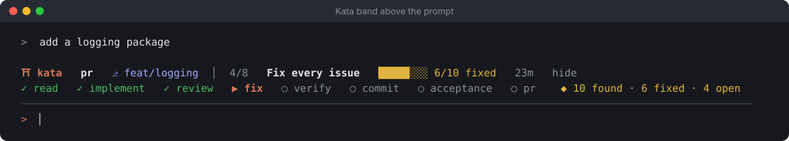
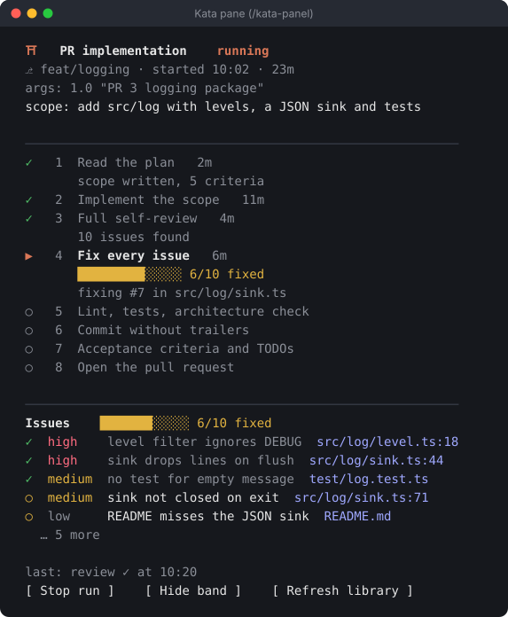

# Kata

Practised sequences for Claude Code.

In martial arts a *kata* is a sequence of moves you drill until it runs on its own. Kata does the same for the work you repeat with Claude. You write each step once as a **command**, chain commands into **modes**, and run them from any terminal session, either a whole mode or a single step, each with its own slash command. While a run goes, Kata shows where it is: the current step, the issues a review found and how many are fixed, the branch, and every step's outcome.



## Install

In a Claude Code session:

```
/plugin install kata --marketplace DeepanshuGautam/kata
```

Answer `y` to add the marketplace, then pick a scope. From a shell: `claude plugin install kata --marketplace DeepanshuGautam/kata`.

On claude.ai or the Claude desktop app: Customize → Plugins → Add → **Add marketplace** → `DeepanshuGautam/kata`, then add **Kata**. It syncs into every Claude Code session signed in with the same account.

## Quick start

A new install starts with an empty library: yours to fill.

```
/kata-setup                     your own private Kata Library page on claude.ai, connected
/kata examples                  the steps library: example commands and modes to copy
/kata-edit add example pr       copy the pull-request workflow below into your library
/kata modes                     the modes you can run
/kata pr "add a logging package" run a mode
/kata-review                    run one step on its own, by its slash command
/kata-panel                     open the live pane
```

Plugin skills are namespaced, so `/kata` is also `/kata:kata`. The Kata mod registers the short name for you.

## Commands, modes and slash commands

A **command** is one instruction Claude carries out, written as an order: "Review the whole change yourself…". It has a title, a gate and an optional slash name.

A **mode** is an ordered list of commands, such as `pr`: read → implement → review → fix → verify → commit → acceptance → pr. One command can sit in many modes, and an edit to it reaches all of them.

**Gates** decide what happens after a step: `continue` goes on, `confirm` pauses and asks you first, and `stop-on-fail` ends the run when the step fails.

**Slash commands**: give any command or mode a `slash` name and the mod registers it. `/kata-review the logging package` runs `/kata run review the logging package`, and a mode's slash name runs the whole mode. A library can hold any number of commands and modes.

## Showcase: a pull-request workflow

This is the workflow Kata was built for, and it ships in the **steps library** (`library/examples.json`) for you to copy and adapt. It is not in your library until you add it.

| Step | Command | Slash | Gate | What Claude does |
|---|---|---|---|---|
| 1 | `read` | `/kata-read` | continue | Reads CLAUDE.md, the plan and the open tasks, then writes a scope statement with acceptance criteria |
| 2 | `implement` | `/kata-implement` | continue | Implements only the scope, with tests, and asks before touching anything outside it |
| 3 | `review` | `/kata-review` | continue | Reviews the whole diff itself and records every issue with severity, file and line |
| 4 | `fix` | `/kata-fix` | confirm | Fixes each open issue, counting fixed out of found, and asks you in plain text when a decision is needed |
| 5 | `verify` | `/kata-verify` | stop-on-fail | Runs lint, tests and the architecture check until they pass, or stops the run |
| 6 | `commit` | `/kata-commit` | continue | Commits only the scoped files, Conventional Commits, no trailers |
| 7 | `acceptance` | `/kata-acceptance` | continue | Checks every criterion with evidence and loops back to implement for anything unmet |
| 8 | `pr` | `/kata-pr` | continue | Opens the pull request with Summary, Description, Testing and Checklist |

Run it as `/kata pr "1.0 PR 3 logging package"`, or any single step by its slash command. While it runs, the band and the pane show where it is:



Build your own the same way: a docs pass, a release, a migration, a bug triage. Each command is one instruction written as an order, and each mode is the order you run them in.

## Where your library lives

| Source | When it is used |
|---|---|
| **Kata Library page** (claude.ai artifact) | When the library source is `artifact` and a page URL is set. `/kata-setup` makes one for you. Edit commands and modes there, reorder steps, rename, set slash names, export JSON. |
| **Local file** `${CLAUDE_PLUGIN_DATA}/library.json` | The offline copy of the page, or your only library when the source is `local`. Edit it with `/kata-edit` or by hand. |
| **Bundled** `library/default.json` | Empty: a fresh install, until either of the above exists. |

The page also has a **Steps library**, where you add example commands and modes with one click, and an **About** view.

Edits on the page reach your terminal sessions when a session starts, every ten minutes, on `/kata-refresh`, and at every `/kata` call. A new or renamed slash command is registered within seconds of that, with nothing to reinstall. `/kata-sync` pulls the page with a diff, and `/kata-sync --from file.json` imports an export.

Share the page with your team, and everyone with the plugin runs the same steps. Only people with edit access can change it.

## Watching a run

The `/kata` skill runs the steps and writes `.claude/kata/state.json` in the project, which is excluded from git. The mod draws it:

- **Band above the prompt:** the mode, the branch, the current step with its progress bar, a trail of every step, and the issue counts. Press *hide* to hide it.
- **Status line:** the same headline in one line.
- **Pane** (`/kata-panel`): every step with its status, duration, activity and note; every issue with severity, file and line, fixed or open; the last command; buttons to stop the run, show or hide the band, and refresh the library. With no run, it lists your modes and commands with their slash commands.
- **Toasts** when a run starts, a step ends and a run ends, plus a **native notification** when a run waits for you or finishes.
- **Commit guard:** during a run, a `git commit` whose message carries `Co-Authored-By`, `Generated with` or `Signed-off-by` is refused. You can set this to always or never.

Commands report progress in a generic way, so your own commands light up the same mods. A step that finds things records them as issues, a step that works through a list reports `done/total`, and a running step names its current activity. The review, fix, verify and acceptance commands in the steps library show the pattern.

## Settings (`/config` → Kata)

| Setting | Default | Meaning |
|---|---|---|
| Library source | artifact | `artifact` or `local` |
| Kata Library artifact URL | empty | the page holding your commands and modes (`/kata-setup` fills it in) |
| Block commit trailers | during-kata | `during-kata`, `always`, `never` |
| Show the run band | on | the band above the prompt during a run |
| Notify when a run waits or ends | on | native notifications through your terminal |

## Commands

| Command | What it does |
|---|---|
| `/kata MODE [args]` | Run a mode |
| `/kata run COMMAND [args]` | Run one command |
| `/kata modes`, `/kata commands` | List the library |
| `/kata examples` | Browse the steps library |
| `/kata status`, `/kata stop` | Show or end the current run |
| `/kata-setup [URL] [--local]` | Create or connect your Kata Library page |
| `/kata-edit …` | Create, change, rename or delete commands and modes, or `add example ID` from the steps library |
| `/kata-sync [--from file]` | Pull the page into the local file, showing what changed |
| `/kata-refresh` | Pull the page now and re-register slash commands |
| `/kata-panel` | Open the pane |
| `/<slash>` | Any command or mode's own slash command |

## Privacy and security

The mod makes no network calls of its own and sends no telemetry. It reads your library page only through Claude Code's own artifact tool, and only when that needs no permission prompt. It runs `git branch` to show the branch. See [SECURITY.md](SECURITY.md) for the threat notes.

## Develop

```
claude --plugin-dir .            load this checkout in a session
claude plugin validate .         manifest and hooks module
claude plugin test .             the mod's tests (hooks/*.test.tsx)
tsc -p .                         type-check, once the engine has written .claude-plugin/types/
```

## License

MIT. Made by [Deepanshu Gautam](https://github.com/DeepanshuGautam).
